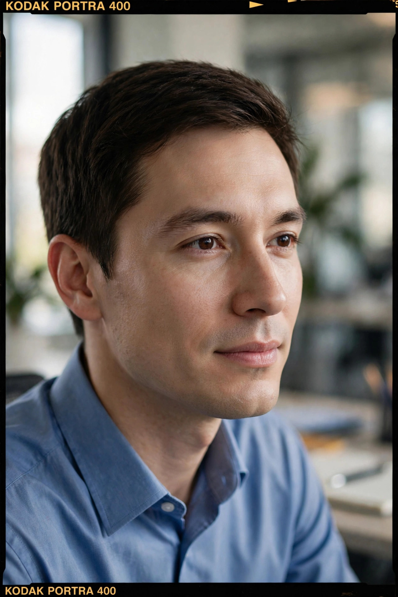
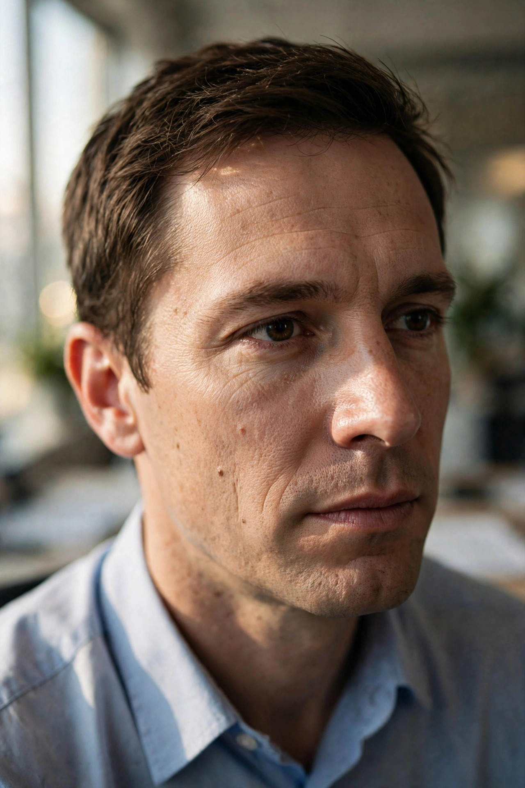

# 已证实样本 · pore-level 皮肤（2026-11-13 第 2 轮）

> **这是本库第一条经过 A/B 对照证实有效的规则**，所以整套原始证据都放在这里。
> 结论：`pore-level skin texture with visible pores and fine lines` 比 `smooth skin` 显著提升皮肤纹理。
> 规则等级：**A（实测成立）**。

---

## 一、验证了什么

| 项 | 内容 |
|---|---|
| 问题 | 在皮肤默认光滑的主体上，「毛孔级皮肤纹理」是否比「光滑皮肤」出更多毛孔和细纹？ |
| 唯一变量 | `smooth skin` → `pore-level skin texture with visible pores and fine lines` |
| 主体 | 30 岁白领（`30-year-old office worker`），`clean-shaven` |
| 光线 | `soft window light from camera left` |
| 镜头 | `85mm lens, f/2.8, shallow depth of field` |
| 胶片 | `Kodak Portra 400 film grain`（这个选择后来引出了 §五.2 的意外发现） |
| 张数 | A 组 4 张 + B 组 4 张 = 8 张 |
| 模型 | Muse 图片生成管线（非 FLUX.1 dev） |

### 两组提示词（原文照抄）

**A 组 · 对照**
```
A close-up portrait of a 30-year-old office worker, clean-shaven, smooth skin,
soft window light from camera left, 85mm lens, f/2.8,
shallow depth of field, Kodak Portra 400 film grain
```

**B 组 · 实验**
```
A close-up portrait of a 30-year-old office worker, clean-shaven,
pore-level skin texture with visible pores and fine lines,
soft window light from camera left, 85mm lens, f/2.8,
shallow depth of field, Kodak Portra 400 film grain
```

---

## 二、结论（带数字）

| 观察项 | A 组（smooth skin） | B 组（pore-level） |
|---|---|---|
| 毛孔「明显」 | **0 / 4** | **4 / 4** |
| 细纹「明显」 | **0 / 4** | **4 / 4** |
| 毛孔「轻微」 | 3 / 4 | 0 / 4 |
| 塑料感 | 1 / 4 轻微 | 0 / 4 |
| 光向命中 | 4 / 4 左 | 4 / 4 左（合计 8/8） |
| 观感年龄 | 约 30 岁 | **33 – 45 岁** |

**判定：成立。**

### 作用方式是「推明显」，不是「从无到有」

A 组 3/4 仍有**轻微**毛孔。`smooth skin` 不是零毛孔，只是把纹理压到不明显。
`pore-level` 的作用是**把纹理从「轻微」推到「明显」**。

写提示词时的含义：
- 要「有质感但不粗糙」→ `smooth skin` + 轻纹理词就够
- 要「近距离能数毛孔」→ 才上 `pore-level`

---

## 三、逐张描述

### A1 · 对照组


深棕短发、浅蓝衬衫的男性，约 30 岁，三分之四侧脸朝右。
皮肤整体光滑、有明显油光；**鼻翼与脸颊能看到淡淡毛孔**，额纹几乎不可见。
上唇与下巴有**轻微胡茬阴影**（提示词要求 `clean-shaven`，未完全满足）。
左窗光，鼻影落在右侧；背景是虚化的办公室。**未出现胶片边框。**

### A2 · 对照组


浅棕／亚麻色头发、深蓝西装配蓝衬衫，正面略偏右，约 30 岁。
**八张里皮肤最光滑的一张**：毛孔、细纹几乎不可见，脸颊略带磨皮感（唯一被判「塑料 轻微」的一张）。
脸颊与下颌有浅胡茬。左窗光，背景为绿植与窗户的高光虚化。

### A3 · 对照组



深发、蓝衬衫，右转四分之三侧脸，约 30 岁。
皮肤光滑，鼻部与颧骨有一点毛孔，整体仍偏平滑。上唇有胡茬。
⚠️ **画面上下出现了 "KODAK PORTRA 400" 文字与胶片齿孔边框**——提示词没要求边框，
是模型把品牌型号理解成「一张柯达负片的实物照片」。这一张直接催生了「不要用品牌胶片型号换颗粒」这条规则。

### A4 · 对照组


深发、深蓝西装配浅蓝衬衫，约 30 岁，朝右前方。
**A 组里纹理最可见的一张**：额头与脸颊毛孔比 A2/A3 明显，
但密度与深度仍不如 B 组任何一张。上唇有轻胡茬，背景有绿植。无明显磨皮感。

### B1 · 实验组


深发、深蓝衬衫，正面略偏左，**观感约 38–42 岁**（远超 30）。
额头有三条清晰横纹，**眉间竖纹深**，眼角鱼尾纹成组；
鼻、脸颊、颧骨毛孔清晰可数；脸颊散落数颗红色小点与痣。
纹理走向符合真实肌肉，**没有**出现第 1 轮那种「核桃壳」。

### B2 · 实验组


深发、浅蓝衬衫，朝右前方，**观感约 33–35 岁**（B 组里最嫩的一张）。
额头有浅横纹，眼角细纹清楚，脸颊与下颌毛孔可见；
肤色偏暖，脸颊有少量小瑕疵。整体仍是「三十出头」的可接受范围。

### B3 · 实验组


深发、浅蓝衬衫，右转侧脸。
⚠️ **尺寸 1600×1600 方幅，其余七张是 1280×1920 竖幅**（管线默认尺寸不可指定）。
额头横纹、颧骨与脸颊毛孔密集清晰，下颌胡茬可见，观感约 36–38 岁；
脸颊有少量红点。纹理密度是八张里最高的一张。

### B4 · 实验组



深发、浅蓝衬衫，朝右前方，**观感约 40–45 岁**（八张里最老）。
额头深横纹、眉间竖纹、眼下纹路齐全；
**左脸颊有两颗明显的痣/色素斑**，下颌与颈部胡茬清楚；脸颊与鼻翼毛孔清晰。
这一张最能说明「`pore-level` 会把年龄推高」这个副作用。

---

## 四、偏差与未控制变量（**读结论前必看**）

| # | 偏差 | 影响 |
|---|---|---|
| 1 | **8 张是 8 个不同的人**，不是同一人 | 个体差异是未控制变量。组间方向一致（B 4/4 明显 vs A 0/4 明显），但严格说不是同体对照 |
| 2 | **A3 有 "KODAK PORTRA 400" 胶片边框与文字** | 未要求产物，见 §五.2；不影响皮肤判定 |
| 3 | **A1、A3 有轻微胡茬阴影** | `clean-shaven` 未完全满足；八张里共 5 张有胡茬 |
| 4 | **B3 尺寸 1600×1600，其余 1280×1920** | 尺寸不可指定；构图仍是面部特写，不影响皮肤判定 |
| 5 | **模型是 Muse 管线，非 FLUX.1 dev** | 结论只适用于该管线，不代表 FLUX / Midjourney |
| 6 | **种子、步数不可指定** | 八张独立随机，不是同种子对照 |
| 7 | **分两轮出**（工具每轮限 4 张） | A1/A2/B1/B2 第一轮，A3/A4/B3/B4 第二轮；模型全程未换 |

---

## 五、这轮额外产出的三条新规则

### 5.1 `pore-level` 会把年龄推高 3–10 岁

记录者原估「32–33 岁」，逐张复核实际是 **33–45 岁**，B1 与 B4 明显超过 40。

要保持「30 岁左右」的观感，**不要整脸上 `pore-level`**，改局部限定：

```
visible pores on the nose and cheeks only, otherwise smooth
```

### 5.2 不要用品牌胶片型号换颗粒

`Kodak Portra 400` 是强先验，模型会连带画出片基边框、齿孔与印刷文字（见 A3）。

| 别写 | 改写 |
|---|---|
| `Kodak Portra 400 film grain` | `fine film grain, warm neutral color balance` |
| `CineStill 800T` | `tungsten-balanced night grade, halation on highlights` |
| `Ilford HP5` | `black and white, coarse visible grain, high contrast` |

非要用品牌，必须补 `no film border, no frame markings, no text`。

### 5.3 `clean-shaven` 一个词压不住胡茬

八张里 5 张仍有胡茬阴影。要真正干净，叠加：

```
smooth shaved jaw, no stubble, no five o'clock shadow
```

---

## 六、还撤回了一条旧规则

第 1 轮（45 岁渔民 + `weathered face`）四张是**同一个人**，
曾据此写成「主体词会锁定同一张脸」。

**本轮 8 张是 8 个不同的人，所以那条不普适，已从规则里撤回**，改为待验证观察。

---

## 七、证据文件

| 文件 | 说明 |
|---|---|
| `A1.jpg` – `A4.jpg` | 对照组原图 |
| `B1.jpg` – `B4.jpg` | 实验组原图 |
| `验证记录_第2轮.html` | **完整验证记录，图片已 base64 内嵌，可离线打开**（约 4 MB） |

> 这个 HTML 是执行方交付的原始证据，未做任何修改。
> 因为内嵌了 8 张图，文件较大（约 4 MB）；如果要控制发布包体积，可以用同目录的 8 张 JPG 替代查看。

---

## 八、怎么用这份样本

1. **当范例读**：想知道「pore-level 到底长什么样」，直接看 B1–B4
2. **当反例读**：想知道「用了会有什么副作用」，看 B1、B4 的年龄，看 A3 的边框
3. **当对照模板**：要验证其它规则时，照这套结构做（唯一变量 + 4v4 + 逐张描述 + 带数字结论）
